# Jarkom-Modul-3-2026-K-41

|         Nama         |     NRP     |
|----------------------|-------------|
|Aliya Rahmadina       | 5027251056  |
|Rayhan Fadhilah Allayn| 5027251126  |

## Soal 1
Ketika Curtain menutup Shibuya, jalur komunikasi antar zona Jujutsu High terputus. Pulihkan konektivitas dasar dengan mengonfigurasi jichi: eth0 memperoleh WAN dari NAT, sedangkan eth1–eth4 menjadi gateway Network 1–4 sesuai tabel pemetaan. Aktifkan IPv4 forwarding dan source NAT, lalu tetapkan IP statis host infrastruktur sesuai tabel spesifikasi. Buktikan konektivitas setiap host ke gateway dan akses eksternal dari host yang relevan.

### Ringkasan
*jichi dikonfigurasi sebagai router utama: `eth0` mendapat WAN dari NAT, `eth1`–`eth4` menjadi gateway Network 1–4 (`10.84.1.1`–`10.84.4.1`, /24), IPv4 forwarding dan source NAT (MASQUERADE) aktif. Seluruh host infrastruktur diberi IP statis, dibuktikan dapat ping ke gateway, dan akses eksternal dibuktikan dari utahime.*

### Langkah Pengerjaan
1. Mencocokkan interface jichi dengan topologi GNS3: `eth0` → NAT1, `eth1` → Switch1 (Network 1), `eth2` → Switch2 (Network 2), `eth3` → Switch4 (Network 3), `eth4` → Switch6 (Network 4).
2. Membuat script `/root/01_jichi.sh` pada jichi. Script menulis blok konfigurasi ke `/root/.bashrc` yang berisi: `eth0` meminta IP dari NAT (dengan cadangan IP statis bila DHCP NAT gagal), IP gateway `eth1`–`eth4`, IPv4 forwarding, rule MASQUERADE pada `eth0`, dan resolver awal `192.168.122.1`.
3. Membuat script `/root/01_host.sh` pada setiap host infrastruktur (image debinet). Script menerima tiga argumen: IP, gateway, dan nama host.
4. Menjalankan script pada jichi, lalu pada tiap host dengan IP dan gateway sesuai tabel.
5. Memverifikasi IP, route, dan konektivitas dengan `ip -br a`, `ip r`, dan `ping`.

### Command
**jichi** — `/root/01_jichi.sh`
```
#!/bin/bash
sed -i '/### SOAL1-JICHI ###/,/### END SOAL1-JICHI ###/d' /root/.bashrc
 
cat >> /root/.bashrc <<'EOF'
### SOAL1-JICHI ###
ifup eth0 2>/dev/null
if ! ip -4 addr show dev eth0 | grep -q "inet"; then
    ip addr add 192.168.122.100/24 dev eth0 2>/dev/null
    ip link set eth0 up
    ip route replace default via 192.168.122.1
fi
 
ip addr add 10.84.1.1/24 dev eth1 2>/dev/null
ip addr add 10.84.2.1/24 dev eth2 2>/dev/null
ip addr add 10.84.3.1/24 dev eth3 2>/dev/null
ip addr add 10.84.4.1/24 dev eth4 2>/dev/null
for i in eth1 eth2 eth3 eth4; do ip link set $i up; done
 
sysctl -w net.ipv4.ip_forward=1 >/dev/null 2>&1
iptables -t nat -C POSTROUTING -o eth0 -j MASQUERADE 2>/dev/null || iptables -t nat -A POSTROUTING -o eth0 -j MASQUERADE
 
echo "nameserver 192.168.122.1" > /etc/resolv.conf
### END SOAL1-JICHI ###
EOF
 
source /root/.bashrc
echo "[jichi] Soal 1 selesai."
```
 
- `ifup eth0`: `eth0` meminta IP dari DHCP milik NAT (hasilnya `192.168.122.x`).
- `ip addr add 10.84.N.1/24 dev ethN`: memasang alamat gateway tiap network.
- `sysctl -w net.ipv4.ip_forward=1`: kernel meneruskan paket antar-interface.
- `iptables -t nat -A POSTROUTING -o eth0 -j MASQUERADE`: source NAT agar paket dari jaringan internal keluar memakai IP `eth0`. Opsi `-C` memeriksa dulu supaya rule tidak ganda.
**Host infrastruktur** — `/root/01_host.sh <IP> <GATEWAY> <NAMA_HOST>`
 
```
#!/bin/bash
IP="$1"
GW="$2"
NAME="$3"
 
if ! grep -q "### SOAL1-HOST ###" /root/.bashrc; then
cat >> /root/.bashrc <<EOF
### SOAL1-HOST ###
hostname $NAME
ip addr add $IP/24 dev eth0 2>/dev/null
ip link set eth0 up
ip route replace default via $GW
echo "nameserver 192.168.122.1" > /etc/resolv.conf
### END SOAL1-HOST ###
EOF
fi
 
source /root/.bashrc
echo "[$NAME] Soal 1 selesai ($IP via $GW)."
```
 
Perintah yang dijalankan di tiap node:
 
```
bash /root/01_host.sh 10.84.1.2  10.84.1.1 utahime
bash /root/01_host.sh 10.84.1.3  10.84.1.1 shoko
bash /root/01_host.sh 10.84.1.4  10.84.1.1 gojo
bash /root/01_host.sh 10.84.4.10 10.84.4.1 tengen
bash /root/01_host.sh 10.84.4.2  10.84.4.1 geto
bash /root/01_host.sh 10.84.4.21 10.84.4.1 maki
bash /root/01_host.sh 10.84.4.22 10.84.4.1 panda
bash /root/01_host.sh 10.84.4.31 10.84.4.1 nanami
bash /root/01_host.sh 10.84.4.32 10.84.4.1 todo
bash /root/01_host.sh 10.84.4.33 10.84.4.1 kirara
bash /root/01_host.sh 10.84.4.41 10.84.4.1 yaga
bash /root/01_host.sh 10.84.4.42 10.84.4.1 inumaki
```
 
**Verifikasi**
 
```
# jichi
ip -br a
ip r
cat /proc/sys/net/ipv4/ip_forward
iptables -t nat -L POSTROUTING -n -v
ping -c 3 192.168.122.1
ping -c 3 8.8.8.8
ping -c 3 google.com
 
# setiap host
hostname
ip -br a
ip r
ping -c 3 <gateway>
 
# host yang relevan (utahime): akses eksternal
ping -c 3 8.8.8.8
ping -c 3 google.com
```
 
Hasil: `eth1`–`eth4` pada jichi ber-IP `10.84.1.1`–`10.84.4.1` (/24), forwarding bernilai `1`, rule `MASQUERADE` aktif pada `eth0`, dan ping ke gateway NAT, `8.8.8.8`, serta `google.com` berhasil. Seluruh 12 host infrastruktur berhasil ping ke gateway masing-masing, dan utahime berhasil mengakses internet melalui NAT jichi.
 
## Soal 2
Tengen, penjaga pusat distribusi di Data Center, harus mengambil alih pengalokasian alamat bagi wilayah yang membutuhkan konfigurasi dinamis. Konfigurasikan isc-dhcp-server pada [PREFIX IP].4.10. Deklarasikan Network 4 ([PREFIX IP].4.0/24) sebagai subnet lokal tanpa pool dinamis, lalu siapkan scope DHCP untuk Network 2 ([PREFIX IP].2.0/24) dan Network 3 ([PREFIX IP].3.0/24). Validasi konfigurasi dan pastikan service aktif tanpa error “No subnet declaration”.

### Ringkasan
*Pada tengen (`10.84.4.10`) dipasang `isc-dhcp-server` dengan `eth0` sebagai interface layanan. Network 4 dideklarasikan sebagai subnet lokal tanpa `range`, sedangkan Network 2 dan Network 3 memiliki scope DHCP. Konfigurasi divalidasi dengan `dhcpd -t` dan service berjalan tanpa error.*

### Langkah Pengerjaan
1. Memasang `isc-dhcp-server` pada tengen (butuh internet melalui jichi dan resolver `192.168.122.1`).
2. Mengatur interface layanan pada `/etc/default/isc-dhcp-server` menjadi `eth0` (`10.84.4.10`).
3. Menulis `/etc/dhcp/dhcpd.conf`: subnet Network 4 **tanpa** `range`, serta scope Network 2 dan Network 3 lengkap dengan `routers` dan `broadcast-address`.
4. Memvalidasi konfigurasi dengan `dhcpd -t`, lalu menjalankan service.
5. Memeriksa status service, proses, dan port UDP 67.
Subnet Network 4 harus dideklarasikan walaupun tanpa pool, karena `dhcpd` menolak berjalan (`No subnet declaration for eth0`) bila interface yang dipakai tidak memiliki subnet yang cocok pada konfigurasi.

### Command
**tengen** — `/root/02_tengen.sh`
 
```
#!/bin/bash
export DEBIAN_FRONTEND=noninteractive
which dhcpd >/dev/null 2>&1 || (apt-get update -y && apt-get install -y isc-dhcp-server)
 
cat > /etc/default/isc-dhcp-server <<'EOF'
INTERFACESv4="eth0"
INTERFACESv6=""
EOF
 
cat > /etc/dhcp/dhcpd.conf <<'EOF'
authoritative;
default-lease-time 600;
max-lease-time 7200;
 
# Network 4 - Data Center (subnet lokal, tanpa pool dinamis)
subnet 10.84.4.0 netmask 255.255.255.0 {
}
 
# Network 2 - Divisi A
subnet 10.84.2.0 netmask 255.255.255.0 {
    range 10.84.2.10 10.84.2.35;
    option routers 10.84.2.1;
    option broadcast-address 10.84.2.255;
}
 
# Network 3 - Divisi B
subnet 10.84.3.0 netmask 255.255.255.0 {
    range 10.84.3.10 10.84.3.89;
    option routers 10.84.3.1;
    option broadcast-address 10.84.3.255;
}
EOF
 
mkdir -p /var/lib/dhcp
touch /var/lib/dhcp/dhcpd.leases
 
dhcpd -t -cf /etc/dhcp/dhcpd.conf && echo "[tengen] Konfigurasi valid."
service isc-dhcp-server restart
echo "[tengen] Soal 2 selesai."
```
 
> Rentang `range` pada Network 2 dan Network 3 di tahap ini bersifat sementara, kemudian ditulis ulang pada Soal 4 sampai Soal 6.
 
**Verifikasi**
 
```
cat /etc/default/isc-dhcp-server
cat /etc/dhcp/dhcpd.conf
dhcpd -t -cf /etc/dhcp/dhcpd.conf
service isc-dhcp-server status
ps aux | grep [d]hcpd
ss -ulnp | grep :67
```
 
Hasil: konfigurasi valid (`[tengen] Konfigurasi valid.`), `dhcpd is running`, proses `dhcpd -4 ... eth0` berjalan, dan `dhcpd` mendengarkan pada UDP `0.0.0.0:67`, tanpa error "No subnet declaration".

## Soal 3
Permintaan alamat dari Divisi A dan Divisi B tidak dapat menyeberangi subnet secara langsung. Konfigurasikan jichi sebagai DHCP Relay menuju tengen ([PREFIX IP].4.10), menggunakan eth2 untuk Network 2 dan eth3 untuk Network 3. Buktikan bahwa client dari kedua subnet berhasil memperoleh lease melalui relay.

### Ringkasan
*jichi dikonfigurasi sebagai DHCP Relay menuju tengen (`10.84.4.10`) untuk Network 2 (`eth2`) dan Network 3 (`eth3`). Interface `eth4` (jalur ke server) ikut diikat agar balasan dari tengen diterima relay. Client itadori (Network 2) dan ino (Network 3) berhasil memperoleh lease melalui relay.*
 
### Langkah Pengerjaan
1. Memasang `isc-dhcp-relay` pada jichi.
2. Mengisi `/etc/default/isc-dhcp-relay` dengan `SERVERS="10.84.4.10"` dan `INTERFACES` berisi `eth2 eth3`, lalu menjalankan service.
3. Menguji dari client Network 2 (itadori) dengan `ip link set eth0 up` dan `udhcpc -i eth0`. **Client tidak memperoleh lease** (`udhcpc failed to get a DHCP lease`).
4. Menangkap paket pada jichi dengan `tcpdump -ni any port 67 or port 68`. Hasilnya: DISCOVER client masuk di `eth2`, diteruskan ke `10.84.4.10` melalui `eth4`, dan balasan dari tengen kembali di `eth4`, tetapi **tidak diteruskan keluar ke `eth2`**. Relay hanya terikat ke `eth2` dan `eth3`, sehingga paket yang datang lewat `eth4` tidak diproses.
5. Menambahkan `eth4` pada `INTERFACES` (`eth2 eth3 eth4`), lalu me-restart relay.
6. Menguji ulang dari itadori (Network 2) dan ino (Network 3). Kedua client memperoleh lease dari server `10.84.4.10`.
7. Memeriksa pencatatan lease pada tengen.

### Command
**jichi** — `/root/03_jichi_relay.sh`
 
```
#!/bin/bash
export DEBIAN_FRONTEND=noninteractive
which dhcrelay >/dev/null 2>&1 || (apt-get update -y && apt-get install -y isc-dhcp-relay)
 
cat > /etc/default/isc-dhcp-relay <<'EOF'
SERVERS="10.84.4.10"
INTERFACES="eth2 eth3 eth4"
OPTIONS=""
EOF
 
service isc-dhcp-relay restart
echo "[jichi] Soal 3 (relay) selesai."
```
 
**Diagnosa** (jichi)
 
```
tcpdump -ni any port 67 or port 68
```
 
**Client** (itadori dan ino)
 
```
ip link set eth0 up
udhcpc -i eth0
ip -br a
ip r
```
 
**Verifikasi**
 
```
# jichi
cat /etc/default/isc-dhcp-relay
ps aux | grep [d]hcrelay
 
# tengen
tail -30 /var/lib/dhcp/dhcpd.leases
```
 
Hasil: proses `dhcrelay -q -i eth2 -i eth3 -i eth4 10.84.4.10` berjalan. itadori memperoleh `10.84.2.10` (gateway `10.84.2.1`) dan ino memperoleh `10.84.3.10` (gateway `10.84.3.1`), keduanya dari server `10.84.4.10`, dan lease tercatat pada `dhcpd.leases` di tengen.

## Soal 4
Agar tim Dev dan Support di Divisi A menerima jatah alamat yang berbeda, atur dua pool DHCP pada Network 2. Tetapkan Pool 1 ([PREFIX IP].2.10–[PREFIX IP].2.35) untuk itadori dan fushiguro, serta Pool 2 ([PREFIX IP].2.70–[PREFIX IP].2.95) untuk zenin dan okkotsu. Rentang [PREFIX IP].2.36–[PREFIX IP].2.69 tidak boleh dialokasikan. Karena seluruh client berada pada subnet yang sama, gunakan DHCP class berdasarkan MAC Address atau Client ID untuk memisahkan kedua kelompok.

### Ringkasan
*Network 2 dibagi menjadi dua pool menggunakan DHCP class berdasarkan MAC address: `pool1` (`10.84.2.10`–`10.84.2.35`) untuk itadori dan fushiguro, `pool2` (`10.84.2.70`–`10.84.2.95`) untuk zenin dan okkotsu. Rentang `10.84.2.36`–`10.84.2.69` tidak dimasukkan ke pool mana pun.*

### Langkah Pengerjaan
1. Mengambil MAC address `eth0` keempat client dengan `ip link show eth0` (dan dicocokkan dengan **Show node information** di GNS3).
2. Mendefinisikan dua class `pool1` dan `pool2` yang mencocokkan `substring(hardware, 1, 6)` dengan MAC masing-masing client.
3. Pada subnet Network 2, mengganti `range` tunggal dengan dua blok `pool`. Setiap pool memiliki `range` sendiri dan `allow members of` class yang bersesuaian.
4. Memvalidasi konfigurasi dan me-restart service di tengen.
5. Meminta lease dari keempat client dan memeriksa IP yang diperoleh.

### Command
**tengen** — `/root/04_tengen_pool.sh` (bagian konfigurasi Network 2)
 
```
class "pool1" {
    match if substring(hardware, 1, 6) = 02:42:ca:0c:2a:00
          or substring(hardware, 1, 6) = 02:42:2c:10:8f:00;
}
class "pool2" {
    match if substring(hardware, 1, 6) = 02:42:4a:14:24:00
          or substring(hardware, 1, 6) = 02:42:bc:7b:16:00;
}
 
subnet 10.84.2.0 netmask 255.255.255.0 {
    option routers 10.84.2.1;
    option broadcast-address 10.84.2.255;
 
    pool {
        range 10.84.2.10 10.84.2.35;
        allow members of "pool1";
    }
    pool {
        range 10.84.2.70 10.84.2.95;
        allow members of "pool2";
    }
}
```
 
```
dhcpd -t -cf /etc/dhcp/dhcpd.conf
service isc-dhcp-server restart
```
 
**Client** (itadori, fushiguro, zenin, okkotsu)
 
```
ip link show eth0
udhcpc -i eth0
ip -br a
```
 
**Verifikasi** (tengen)
 
```
cat /etc/dhcp/dhcpd.conf
tail -60 /var/lib/dhcp/dhcpd.leases
```
 
Hasil:
 
| Client | IP | Pool |
|---|---|---|
| itadori | `10.84.2.10` | Pool 1 |
| fushiguro | `10.84.2.11` | Pool 1 |
| zenin | `10.84.2.70` | Pool 2 |
| okkotsu | `10.84.2.71` | Pool 2 |
 
Tidak ada client yang memperoleh alamat pada `10.84.2.36`–`10.84.2.69`.

## Soal 5
Setiap tim lapangan memiliki durasi operasi yang berbeda. Pada Network 3, berikan short lease 30 menit (1800 detik) kepada ino dan kusakabe, serta long lease 12 jam (43200 detik) kepada miwa. Gunakan pool short lease [PREFIX IP].3.10–[PREFIX IP].3.89 dan pool long lease [PREFIX IP].3.100–[PREFIX IP].3.199. Sesuaikan default-lease-time dan max-lease-time untuk setiap kelas client. Berikan pula DHCP options berupa DNS [PREFIX IP].1.2 dan [PREFIX IP].1.3, serta domain-search <xxxx>.com.

### Ringkasan
*Network 3 dibagi dengan class `short` (ino, kusakabe; lease 1800 detik; pool `10.84.3.10`–`10.84.3.89`) dan class `long` (miwa; lease 43200 detik; pool `10.84.3.100`–`10.84.3.199`). DHCP options diberikan ke semua client: DNS `10.84.1.2` dan `10.84.1.3`, serta domain-search `K41.com`.*

### Langkah Pengerjaan
1. Menambahkan option global `domain-name-servers 10.84.1.2, 10.84.1.3` dan `domain-search "K41.com"` pada `dhcpd.conf`.
2. Mendefinisikan class `short` (MAC ino dan kusakabe) dengan `default-lease-time 1800` dan `max-lease-time 1800`, serta class `long` (MAC miwa) dengan `default-lease-time 43200` dan `max-lease-time 43200`.
3. Mengganti `range` pada subnet Network 3 dengan dua blok `pool` yang masing-masing mengizinkan class `short` dan `long`.
4. Memvalidasi konfigurasi dan me-restart service di tengen.
5. Meminta lease dari ino, kusakabe, dan miwa, lalu memeriksa lease time, `resolv.conf`, dan `dhcpd.leases`.
6. Membuktikan domain-search sampai ke client. `udhcpc` secara bawaan tidak meminta option 119 (domain-search), sehingga ditambahkan `-O 119` dan opsi yang diterima dicetak dengan script `-s`.

### Command
**tengen** — `/root/05_tengen_lease.sh` (bagian yang ditambahkan)
 
```
option domain-name-servers 10.84.1.2, 10.84.1.3;
option domain-search "K41.com";
 
class "short" {
    match if substring(hardware, 1, 6) = 02:42:7d:1f:d9:00
          or substring(hardware, 1, 6) = 02:42:65:95:ef:00;
    default-lease-time 1800;
    max-lease-time 1800;
}
class "long" {
    match if substring(hardware, 1, 6) = 02:42:90:34:fc:00;
    default-lease-time 43200;
    max-lease-time 43200;
}
 
subnet 10.84.3.0 netmask 255.255.255.0 {
    option routers 10.84.3.1;
    option broadcast-address 10.84.3.255;
 
    pool {
        range 10.84.3.10 10.84.3.89;
        allow members of "short";
    }
    pool {
        range 10.84.3.100 10.84.3.199;
        allow members of "long";
    }
}
```
 
Konfigurasi lengkap (class Network 2 dari Soal 4 tetap ada) ditulis ulang oleh script, lalu:
 
```
dhcpd -t -cf /etc/dhcp/dhcpd.conf
service isc-dhcp-server restart
```
 
**Client** (ino, kusakabe, miwa)
 
```
ip link show eth0
udhcpc -i eth0
ip -br a
cat /etc/resolv.conf
```
 
**Bukti domain-search** (kusakabe)
 
```
printf '#!/bin/sh\nenv | grep -E "^(search|domain|dns|router|subnet|broadcast|lease)"\n' > /tmp/show.sh
chmod +x /tmp/show.sh
udhcpc -i eth0 -n -q -s /tmp/show.sh              # tanpa option 119: tidak ada baris search
udhcpc -i eth0 -n -q -O 119 -s /tmp/show.sh       # dengan option 119: search=K41.com
```
 
**Verifikasi** (tengen)
 
```
cat /etc/dhcp/dhcpd.conf
dhcpd -t -cf /etc/dhcp/dhcpd.conf
tail -60 /var/lib/dhcp/dhcpd.leases
```
 
Hasil:
 
| Client | IP | Lease time | Pool |
|---|---|---|---|
| ino | `10.84.3.10` | 1800 detik (30 menit) | short |
| kusakabe | `10.84.3.11` | 1800 detik (30 menit) | short |
| miwa | `10.84.3.100` | 43200 detik (12 jam) | long |
 
`resolv.conf` ketiga client berisi `nameserver 10.84.1.2` dan `nameserver 10.84.1.3`. Pada `dhcpd.leases`, lease ino dan kusakabe berselisih 30 menit antara `starts` dan `ends`, sedangkan lease miwa berselisih 12 jam. Dengan `-O 119`, client menerima `search=K41.com`.

Catatan: angka lease time di client dapat lebih kecil dari nilai penuh (misalnya `1796`) karena client sedang memperbarui lease yang masih aktif, sehingga server mengembalikan sisa waktunya. Nilai di server tetap 1800 detik.

## Soal 6

### Ringkasan

### Langkah Pengerjaan

### Command

## Soal 7

### Ringkasan

### Langkah Pengerjaan

### Command

## Soal 8

### Ringkasan

### Langkah Pengerjaan

### Command

## Soal 9

### Ringkasan

### Langkah Pengerjaan

### Command

## Soal 10

### Ringkasan

### Langkah Pengerjaan

### Command

## Soal 11
Utahime dan Shoko ditugaskan membangun sistem penamaan domain resmi agar seluruh pos tidak perlu menghafal alamat IP mentah. Konfigurasikan BIND9 pada **utahime** sebagai **DNS Master** dan **shoko** sebagai **DNS Slave** untuk mengelola domain `jujutsu.<xxxx>.com`. Atur SOA record, NS delegasi untuk kedua server, dan terapkan **allow-transfer** dari Master ke Slave. Pastikan file zona berhasil tersinkronisasi otomatis ke shoko saat nomor serial di utahime dinaikkan, lalu buktikan dengan melakukan query **dig** ke kedua server dari salah satu client.
 
### Ringkasan
*Utahime menjadi DNS Master dan shoko DNS Slave untuk zona `jujutsu.K41.com`. SOA dan NS untuk kedua server diatur, `allow-transfer` hanya ke shoko, dan zona ikut tersinkron saat serial di utahime dinaikkan. Dibuktikan dengan `dig` dari client.*
 
### 1. Langkah Pengerjaan
 
1. Memasang `bind9` pada utahime dan shoko (resolver `192.168.122.1` dipakai agar `apt-get` berjalan).
2. Pada utahime: menulis `named.conf.options`, `named.conf.local` (zona `master`, `notify`, `also-notify` dan `allow-transfer` ke `10.84.1.3`), serta file zona `/etc/bind/jujutsu/jujutsu.K41.com` berisi SOA dan dua NS.
3. Pada shoko: menulis zona bertipe `slave` dengan `masters { 10.84.1.2; }`. File zona disimpan di `/var/cache/bind/` karena hanya direktori itu yang bisa ditulis oleh user `bind`.
4. Memvalidasi dengan `named-checkconf` dan `named-checkzone`, lalu `service named restart` di utahime terlebih dahulu, kemudian di shoko.
5. Menaikkan serial SOA di utahime, lalu memeriksa bahwa serial di shoko ikut berubah tanpa menyentuh shoko.
6. Menguji dari client (itadori) dengan `dig` ke kedua server, termasuk membuktikan `allow-transfer` dengan AXFR.
### 2. Command
 
**utahime** — `11_utahime.sh`
```sh
apt-get update
apt-get install bind9 bind9-utils bind9-dnsutils -y
mkdir -p /etc/bind/jujutsu
```
 
`/etc/bind/named.conf.local`
```
zone "jujutsu.K41.com" {
    type master;
    file "/etc/bind/jujutsu/jujutsu.K41.com";
    notify yes;
    also-notify { 10.84.1.3; };
    allow-transfer { 10.84.1.3; };
};
```
 
`/etc/bind/jujutsu/jujutsu.K41.com`
```
$TTL 604800
@   IN  SOA ns1.jujutsu.K41.com. root.jujutsu.K41.com. (
            2026101501  ; serial
            3600
            600
            604800
            86400 )
@   IN  NS  ns1.jujutsu.K41.com.
@   IN  NS  ns2.jujutsu.K41.com.
ns1 IN  A   10.84.1.2
ns2 IN  A   10.84.1.3
```
 
**shoko** — `11_shoko.sh`, `/etc/bind/named.conf.local`
```
zone "jujutsu.K41.com" {
    type slave;
    masters { 10.84.1.2; };
    file "/var/cache/bind/jujutsu.K41.com";
};
```
 
**Validasi dan restart**
```sh
# utahime
named-checkconf
named-checkzone jujutsu.K41.com /etc/bind/jujutsu/jujutsu.K41.com
service named restart
# shoko
named-checkconf
service named restart
```
 
**Verifikasi** (serial dinaikkan di utahime, lalu dicek dari shoko dan itadori)
```sh
# shoko
dig @10.84.1.3 jujutsu.K41.com SOA +short
dig @10.84.1.2 jujutsu.K41.com AXFR       # boleh, hanya shoko yang diizinkan
 
# itadori
dig @10.84.1.2 jujutsu.K41.com SOA +short
dig @10.84.1.3 jujutsu.K41.com SOA +short
dig @10.84.1.2 jujutsu.K41.com AXFR       # harus "Transfer failed"
```
 
Zona di shoko berisi isi yang sama dengan utahime (`allow-transfer` hanya untuk shoko):
 
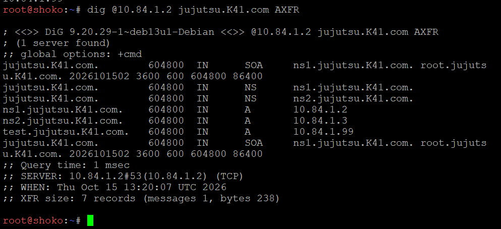
 
> 📸 `dig AXFR` dari shoko ke utahime menampilkan seluruh isi zona (SOA serial `2026101502`, dua NS, A record ns1 dan ns2, serta record uji `test` yang ditambahkan untuk membuktikan sinkronisasi saat serial dinaikkan).
 
Dari itadori, AXFR ditolak dan kedua server menjawab serial yang sama:
 
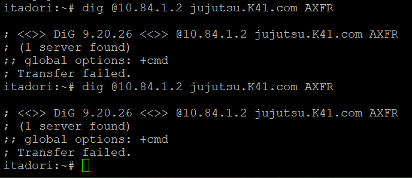
 
> 📸 `dig AXFR` dari itadori ke utahime menghasilkan `Transfer failed`.
 
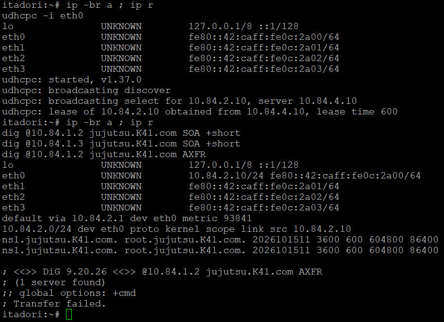
 
> 📸 itadori memperoleh IP dari DHCP, lalu `dig SOA +short` ke `10.84.1.2` dan `10.84.1.3` menjawab serial `2026101511` yang sama.
 
> Catatan: node GNS3 berbasis container tanpa systemd, sehingga paket BIND9 dan konfigurasi hilang setiap project di-restart. Karena itu seluruh langkah disimpan di `/root` sebagai script dan dipanggil dari blok pada `/root/.bashrc`. Serial SOA juga harus selalu dinaikkan di dalam script, karena slave menolak zona dengan serial yang lebih kecil.
 
---
 
## Soal 12
Peta domain harus memetakan pintu masuk utama dan tetap bisa mencari alamat di luar kawasan Shibuya. Pada **utahime**, buat A record `jujutsu.<xxxx>.com` yang mengarah ke gojo, serta CNAME **www** yang merujuk ke domain utama tersebut. Buat pula Reverse DNS (zona PTR) untuk melacak IP gojo kembali ke domain resminya, dan aktifkan fitur DNS Forwarder pada BIND9 mengarah ke IP gateway internet **(192.168.122.1)**. Uji dari client dengan **dig** untuk mengecek CNAME, PTR, dan buktikan client tetap bisa melakukan ping ke domain internet seperti **google.com**.
 
### Ringkasan
*Pada utahime ditambahkan A record `jujutsu.K41.com` ke gojo (`10.84.1.4`), CNAME `www` ke domain utama, zona reverse `1.84.10.in-addr.arpa` dengan PTR untuk gojo, dan forwarder `192.168.122.1`. Diuji dari client dengan `dig` (CNAME, PTR) dan `ping google.com`.*
 
### 1. Langkah Pengerjaan
 
1. Menambahkan A record apex `jujutsu.K41.com` ke `10.84.1.4` dan CNAME `www` pada file zona di utahime.
2. Membuat file zona reverse `/etc/bind/jujutsu/db.10.84.1` berisi PTR untuk `10.84.1.2`, `10.84.1.3`, dan `10.84.1.4`, lalu mendeklarasikannya sebagai zona `master` di `named.conf.local`.
3. Mengaktifkan `forwarders { 192.168.122.1; }` dengan `forward only` di `named.conf.options`, dan membatasi rekursi hanya untuk jaringan internal `10.84.0.0/16`.
4. Menaikkan serial SOA menjadi `2026101512` pada kedua zona.
5. Pada shoko: mendeklarasikan zona reverse sebagai `slave`, dan memasang forwarder yang sama.
6. Memvalidasi dengan `named-checkzone`, restart `named` di utahime lalu shoko, kemudian menguji dari client.
### 2. Command
 
**utahime** — tambahan di `/etc/bind/named.conf.options`
```
recursion yes;
allow-recursion { 10.84.0.0/16; 127.0.0.1; };
forwarders { 192.168.122.1; };
forward only;
```
 
**utahime** — tambahan di `/etc/bind/named.conf.local`
```
zone "1.84.10.in-addr.arpa" {
    type master;
    file "/etc/bind/jujutsu/db.10.84.1";
    notify yes;
    also-notify { 10.84.1.3; };
    allow-transfer { 10.84.1.3; };
};
```
 
**utahime** — tambahan di `/etc/bind/jujutsu/jujutsu.K41.com` (serial `2026101512`)
```
@   IN  A      10.84.1.4
www IN  CNAME  jujutsu.K41.com.
```
 
**utahime** — `/etc/bind/jujutsu/db.10.84.1`
```
$TTL 604800
@   IN  SOA ns1.jujutsu.K41.com. root.jujutsu.K41.com. (
            2026101512  ; serial
            3600
            600
            604800
            86400 )
@   IN  NS  ns1.jujutsu.K41.com.
@   IN  NS  ns2.jujutsu.K41.com.
2   IN  PTR ns1.jujutsu.K41.com.
3   IN  PTR ns2.jujutsu.K41.com.
4   IN  PTR jujutsu.K41.com.
```
 
**shoko** — tambahan di `/etc/bind/named.conf.local` dan `named.conf.options`
```
zone "1.84.10.in-addr.arpa" {
    type slave;
    masters { 10.84.1.2; };
    file "/var/cache/bind/db.10.84.1";
};
```
`named.conf.options` memakai `forwarders` dan `allow-recursion` yang sama dengan utahime.
 
**Validasi dan restart**
```sh
named-checkzone jujutsu.K41.com /etc/bind/jujutsu/jujutsu.K41.com
named-checkzone 1.84.10.in-addr.arpa /etc/bind/jujutsu/db.10.84.1
service named restart      # utahime, lalu shoko
```
 
**Verifikasi** (dari itadori)
```sh
dig @10.84.1.2 jujutsu.K41.com A +short
dig @10.84.1.3 jujutsu.K41.com A +short
dig @10.84.1.2 www.jujutsu.K41.com CNAME
dig @10.84.1.3 www.jujutsu.K41.com CNAME
dig @10.84.1.2 -x 10.84.1.4
dig @10.84.1.3 -x 10.84.1.4
dig google.com +short
ping -c 3 google.com
```
 
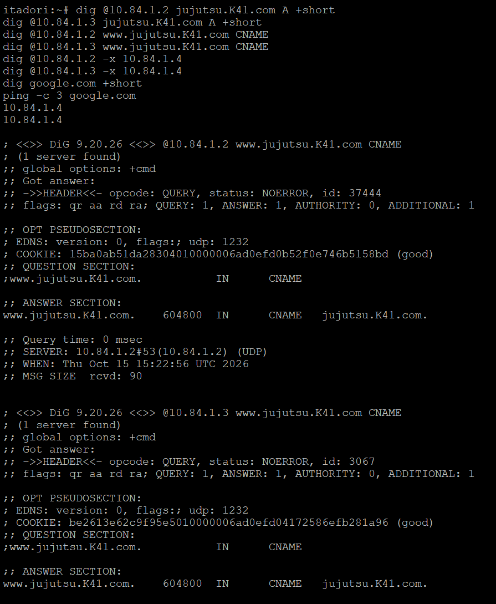
 
> 📸 `dig A` dan `dig CNAME` dari itadori ke kedua server: `jujutsu.K41.com` menjawab `10.84.1.4`, `www` menjawab CNAME ke `jujutsu.K41.com.` dengan `status: NOERROR` dan flag `aa`.
 
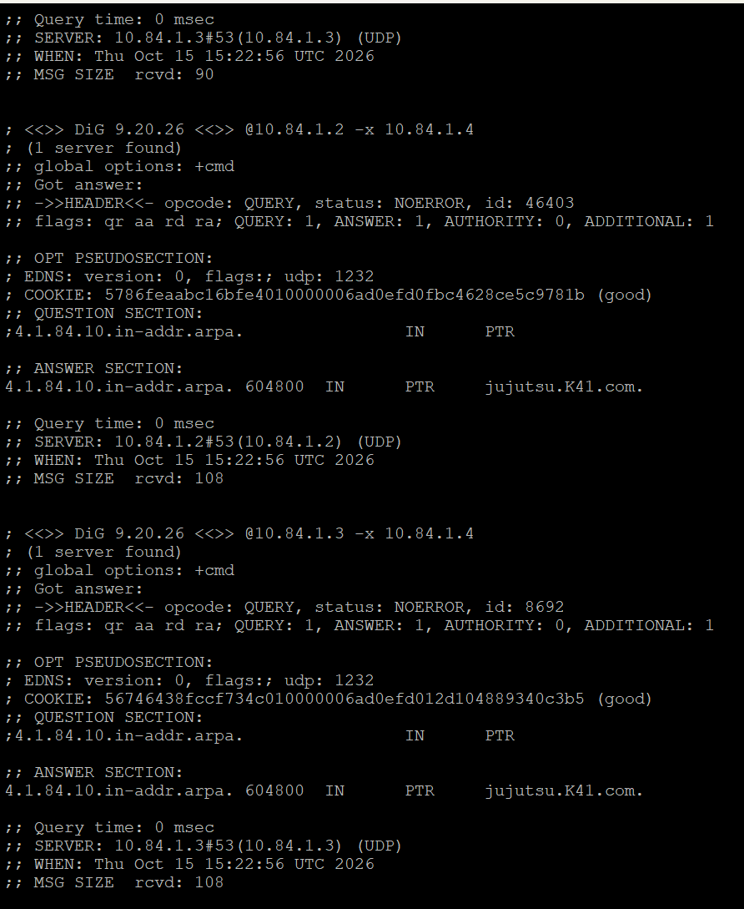
 
> 📸 `dig -x 10.84.1.4` ke utahime dan shoko menjawab PTR `jujutsu.K41.com.`
 
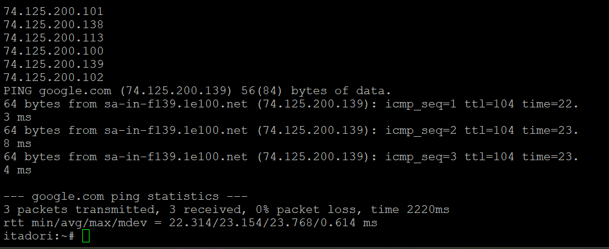
 
> 📸 `dig google.com` berhasil dan `ping -c 3 google.com` dari itadori berhasil tanpa packet loss, membuktikan forwarder aktif.
 
Pemeriksaan di sisi server:
 
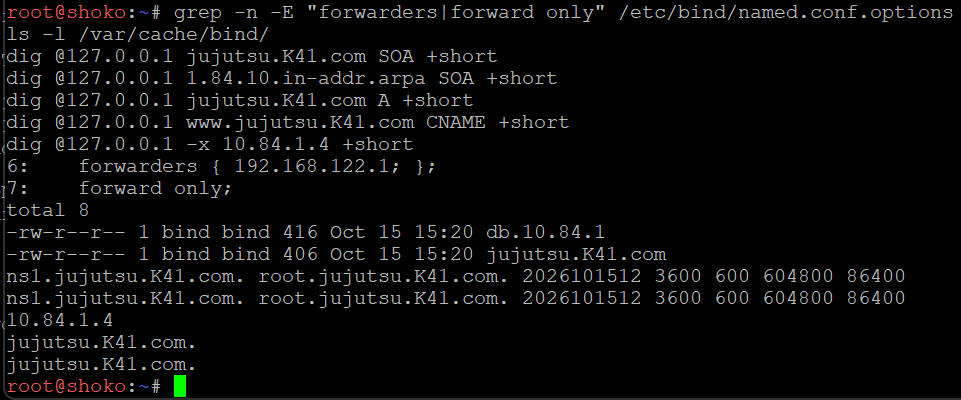
 
> 📸 shoko: `forwarders` dan `forward only` aktif, file `db.10.84.1` dan `jujutsu.K41.com` ada di `/var/cache/bind/`, serial kedua zona `2026101512`, serta A, CNAME, dan PTR terjawab.
 
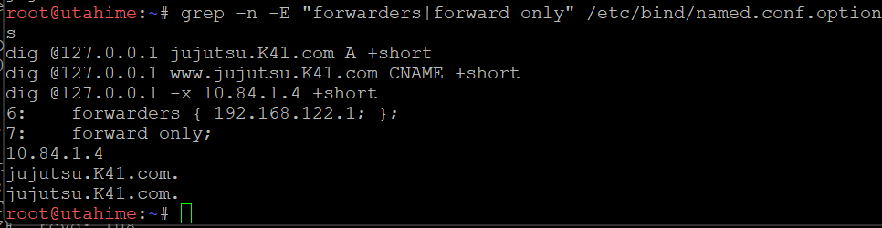
 
> 📸 utahime: `forwarders` dan `forward only` aktif, serta A, CNAME, dan PTR terjawab dari `127.0.0.1`.
 
---
 
## Soal 13
Kepala Sekolah Yaga dan Inumaki mendirikan database terpusat yang redundan agar log aktivitas kutukan tetap aman tersimpan. Konfigurasikan MariaDB pada **yaga** sebagai **DB-Master** dan **inumaki** sebagai **DB-Slave.** Buat database `db_shibuya_<xxxx>` beserta tabel **request_logs** di Master, aktifkan binary logging (log-bin, server-id), lalu hubungkan inumaki sebagai Slave yang menyalin data secara realtime dengan **CHANGE MASTER TO**. Berikan hak akses remote bagi seluruh node di Network 4, lalu buktikan replikasi berhasil dengan memasukkan data baru di Master dan memeriksa hasilnya di Slave.
 
### Ringkasan
*MariaDB di yaga menjadi Master (`server-id 1`, `log_bin`) dengan database `db_shibuya_K41` dan tabel `request_logs`. Inumaki menjadi Slave (`server-id 2`) lewat `CHANGE MASTER TO`. Akun remote dibuat untuk seluruh `10.84.4.%`. Replikasi dibuktikan dengan `INSERT` di yaga yang muncul di inumaki.*
 
### 1. Langkah Pengerjaan
 
1. Memasang `mariadb-server` pada yaga dan inumaki.
2. Pada yaga: menulis `/etc/mysql/mariadb.conf.d/99-shibuya.cnf` (`bind-address = 0.0.0.0`, `server-id = 1`, `log_bin`, `binlog_format = ROW`), lalu menyiapkan data awal dengan `mariadb-install-db` bila `/var/lib/mysql` masih kosong.
3. Pada yaga: membuat database `db_shibuya_K41`, tabel `request_logs`, akun `repl` (hak `REPLICATION SLAVE`) dan akun `shibuya` (hak penuh atas database tersebut), keduanya untuk host `10.84.4.%`.
4. Pada inumaki: menulis konfigurasi `server-id = 2`, `relay_log`, `read_only = 1`, lalu `CHANGE MASTER TO` ke `10.84.4.41` dengan `MASTER_USE_GTID=slave_pos` dan `START SLAVE`.
5. Memeriksa `SHOW SLAVE STATUS\G`, lalu menguji replikasi dan akses remote.
### 2. Command
 
**yaga** — `/etc/mysql/mariadb.conf.d/99-shibuya.cnf`
```
[mysqld]
bind-address     = 0.0.0.0
skip-name-resolve
server-id        = 1
log_bin          = /var/log/mysql/mariadb-bin
binlog_format    = ROW
```
 
**yaga** — SQL
```sql
CREATE DATABASE IF NOT EXISTS db_shibuya_K41;
CREATE TABLE IF NOT EXISTS db_shibuya_K41.request_logs (
  id INT AUTO_INCREMENT PRIMARY KEY,
  request_time TIMESTAMP DEFAULT CURRENT_TIMESTAMP,
  client_ip VARCHAR(45),
  request_path VARCHAR(255),
  status_code INT,
  handled_by VARCHAR(50)
);
CREATE USER IF NOT EXISTS 'repl'@'10.84.4.%' IDENTIFIED BY 'ReplK41!';
GRANT REPLICATION SLAVE ON *.* TO 'repl'@'10.84.4.%';
CREATE USER IF NOT EXISTS 'shibuya'@'10.84.4.%' IDENTIFIED BY 'ShibuyaK41!';
GRANT ALL PRIVILEGES ON db_shibuya_K41.* TO 'shibuya'@'10.84.4.%';
FLUSH PRIVILEGES;
```
 
**inumaki** — `/etc/mysql/mariadb.conf.d/99-shibuya.cnf` dan SQL
```
[mysqld]
bind-address     = 0.0.0.0
skip-name-resolve
server-id        = 2
relay_log        = /var/log/mysql/relay-bin
read_only        = 1
```
```sql
STOP SLAVE;
RESET SLAVE ALL;
CHANGE MASTER TO
  MASTER_HOST='10.84.4.41',
  MASTER_USER='repl',
  MASTER_PASSWORD='ReplK41!',
  MASTER_USE_GTID=slave_pos;
START SLAVE;
```
Karena master dibangun dari awal oleh script, `MASTER_USE_GTID=slave_pos` membuat slave membaca binary log dari awal, sehingga database, tabel, dan user ikut tereplikasi tanpa `mysqldump`.
 
**Verifikasi**
```sh
# yaga
mariadb -e "SHOW DATABASES;"
mariadb -e "DESCRIBE db_shibuya_K41.request_logs;"
mariadb -e "SELECT user,host FROM mysql.user;"
mariadb -e "SHOW VARIABLES LIKE 'log_bin'; SHOW VARIABLES LIKE 'server_id';"
mariadb -e "INSERT INTO db_shibuya_K41.request_logs (client_ip, request_path, status_code, handled_by) VALUES ('10.84.2.10','/',200,'maki'), ('10.84.3.10','/api',200,'nanami');"
 
# inumaki
mariadb -e "SHOW SLAVE STATUS\G" | grep -E "Slave_IO_Running|Slave_SQL_Running|Seconds_Behind_Master"
mariadb -e "SELECT * FROM db_shibuya_K41.request_logs;"
mariadb -h 10.84.4.41 -u shibuya -p'ShibuyaK41!' -e "SHOW DATABASES; SELECT COUNT(*) FROM db_shibuya_K41.request_logs;"
```
 

 
> 📸 yaga: `mariadbd` berjalan, port `3306` mendengarkan di `0.0.0.0`, database `db_shibuya_K41` ada, struktur tabel `request_logs`, serta user `repl` dan `shibuya` untuk `10.84.4.%`.
 

 
> 📸 yaga: `log_bin = ON`, `server_id = 1`, dan `INSERT` dua baris pertama ke `request_logs`.
 

 
> 📸 inumaki: `Slave_IO_Running` dan `Slave_SQL_Running` bernilai `Yes`, `Seconds_Behind_Master` bernilai `0`, dua baris data muncul, dan login remote akun `shibuya` ke yaga berhasil.
 
Penyalinan realtime dibuktikan dengan satu `INSERT` tambahan di yaga:
 

 
> 📸 yaga: `INSERT` baris ketiga dengan `handled_by = todo`.
 

 
> 📸 inumaki: `SELECT` menampilkan tiga baris, termasuk baris `todo` yang baru dimasukkan di yaga.
 
---
 
## Soal 14
Para penyihir lapangan bersiaga di Data Center sebagai pekerja backend untuk memproses aplikasi. Pasang Nginx dan PHP-FPM pada **maki** dan **panda** untuk menyajikan web frontend yang menampilkan hostname masing-masing. Pada **nanami**, **todo**, dan **kirara**, siapkan layanan API yang mencatat log request ke database **yaga**. Konfigurasikan virtual host agar worker merespons domain layanan yang ditentukan. Batasi akses langsung dari klien ke worker, web worker hanya menerima trafik melalui jalur proxy web yang ditentukan, sedangkan worker API hanya menerima trafik melalui **geto.** Uji bahwa akses langsung dari klien ditolak, sementara akses melalui reverse proxy tetap berhasil.
 
### Ringkasan
*Maki dan panda menjalankan Nginx dan PHP-FPM sebagai frontend yang menampilkan hostname. Nanami, todo, dan kirara menjalankan API PHP yang mencatat request ke `request_logs` di yaga. Virtual host melayani `jujutsu.K41.com`. Web worker hanya menerima trafik dari gojo (`10.84.1.4`) dan API worker hanya dari geto (`10.84.4.2`). Akses langsung dari client dibuktikan ditolak (403).*
 
### 1. Langkah Pengerjaan
 
1. Memasang `nginx`, `php-fpm`, dan `php-mysql` pada kelima worker. Satu script (`14_<hostname>.sh`) dipakai di semua node, perannya ditentukan dari hostname (`maki` dan `panda` sebagai web, `nanami`, `todo`, dan `kirara` sebagai API).
2. Pada web worker: membuat `/var/www/web/index.php` yang menampilkan `gethostname()`.
3. Pada API worker: membuat `/var/www/api/index.php` yang menyimpan request ke tabel `request_logs` di yaga (akun `shibuya` ke `10.84.4.41`) dan mengembalikan JSON.
4. Membuat virtual host `jujutsu` dengan `server_name jujutsu.K41.com www.jujutsu.K41.com` dan pembatasan `allow` dan `deny all`: web worker hanya menerima `10.84.1.4` (gojo), API worker hanya `10.84.4.2` (geto). `127.0.0.1` tetap diizinkan untuk uji lokal.
5. Memvalidasi dengan `nginx -t`, lalu restart `php8.4-fpm` dan `nginx`.
6. Menguji lokal di tiap worker, lalu menguji akses langsung dari client yang harus ditolak. Uji melalui reverse proxy dilakukan setelah gojo dan geto terpasang (Soal 15 dan 16).
### 2. Command
 
**maki dan panda** — server block (web)
```nginx
server {
    listen 80 default_server;
    server_name jujutsu.K41.com www.jujutsu.K41.com;
    root /var/www/web;
    index index.php;
 
    allow 127.0.0.1;
    allow 10.84.1.4;      # gojo
    deny all;
 
    location / { try_files $uri $uri/ =404; }
    location ~ \.php$ {
        include snippets/fastcgi-php.conf;
        fastcgi_pass unix:/run/php/php8.4-fpm.sock;
    }
}
```
 
**nanami, todo, kirara** — server block (API)
```nginx
server {
    listen 80 default_server;
    server_name jujutsu.K41.com www.jujutsu.K41.com;
 
    allow 127.0.0.1;
    allow 10.84.4.2;      # geto
    deny all;
 
    location ^~ /api {
        include fastcgi_params;
        fastcgi_param SCRIPT_FILENAME /var/www/api/index.php;
        fastcgi_pass unix:/run/php/php8.4-fpm.sock;
    }
    location / { return 404; }
}
```
 
**Verifikasi**
```sh
# uji lokal di tiap worker
curl -s -H "Host: jujutsu.K41.com" http://127.0.0.1/           # maki, panda
curl -s -H "Host: jujutsu.K41.com" http://127.0.0.1/api        # nanami, todo, kirara
 
# yaga
mariadb -e "SELECT * FROM db_shibuya_K41.request_logs ORDER BY id DESC LIMIT 5;"
 
# itadori: akses langsung harus ditolak
curl -i http://10.84.4.21/
curl -i http://10.84.4.22/
curl -i http://10.84.4.31/api
curl -i http://10.84.4.32/api
curl -i http://10.84.4.33/api
```
 
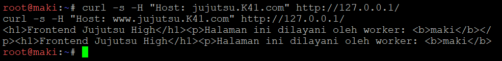
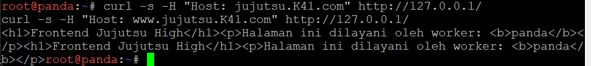
 
> 📸 `curl` lokal di maki dan panda menampilkan halaman frontend dengan hostname masing-masing.
 
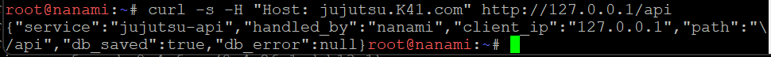
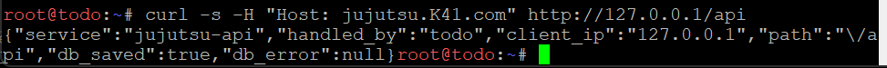
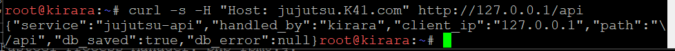
 
> 📸 `curl` lokal ke `/api` di nanami, todo, dan kirara menjawab JSON valid dengan `db_saved: true` dan `db_error: null`.
 
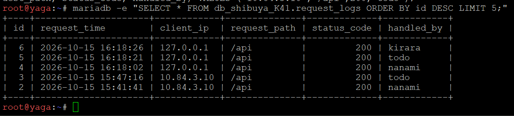
 
> 📸 yaga: baris `request_logs` dari nanami, todo, dan kirara tercatat (`client_ip` masih `127.0.0.1` karena diuji dari worker itu sendiri).
 
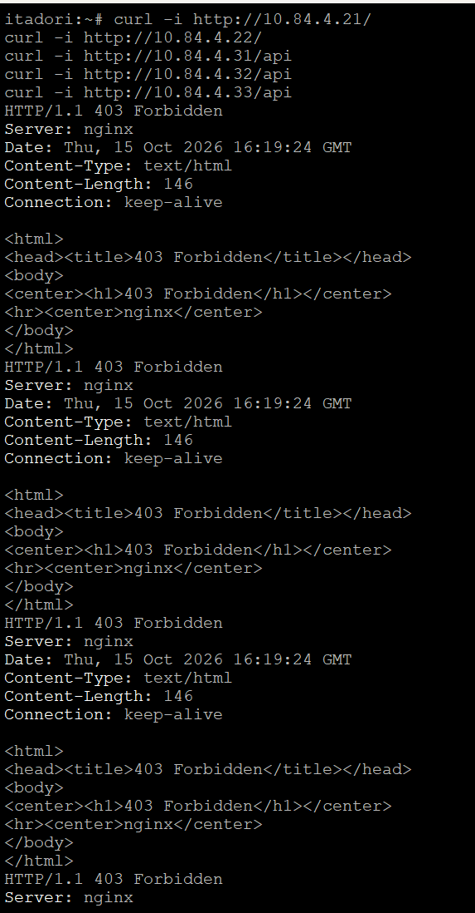
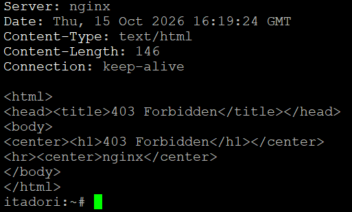
 
> 📸 itadori: akses langsung ke kelima worker menghasilkan `HTTP/1.1 403 Forbidden` dari nginx.
 
Bagian "melalui reverse proxy tetap berhasil" dibuktikan pada Soal 16, ketika akses lewat gojo (`http://jujutsu.K41.com/` dan `/api`) menghasilkan `200`, sedangkan akses langsung ke worker tetap `403`.
 
---
 
## Soal 15
Geto bertugas mengendalikan pembagian beban request API di internal Data Center agar server tidak tumbang bersamaan. Konfigurasikan **Nginx** pada **geto** sebagai **Load Balancer** internal dengan upstream `api_cluster` yang mengarahkan trafik ke **nanami** dan **todo**. Terapkan algoritma **Weighted Round Robin** dengan bobot **3:1**, di mana nanami menerima porsi beban tiga kali lebih banyak daripada todo. Buktikan distribusi beban ini dengan melakukan loop request berulang kali ke geto dari jaringan lokal Data Center dan periksa rasio responnya.
 
### Ringkasan
*Geto menjalankan Nginx dengan upstream `api_cluster` berisi nanami (`weight=3`) dan todo (`weight=1`). Rasio 3:1 dibuktikan dengan loop request dari maki ke geto dan dihitung dengan `uniq -c`.*
 
### 1. Langkah Pengerjaan
 
1. Memasang `nginx` dan `curl` pada geto.
2. Membuat `upstream api_cluster` berisi `10.84.4.31 weight=3` dan `10.84.4.32 weight=1`. Direktif `zone api_cluster 64k;` ditambahkan supaya hitungan round robin dibagi antar worker process Nginx, jika tidak rasio tidak persis 3:1.
3. Meneruskan path `/api` ke upstream dengan `proxy_pass http://api_cluster;`.
4. Memvalidasi dengan `nginx -t`, lalu `service nginx restart`.
5. Menguji dari maki (jaringan Data Center) dengan loop request ke geto, kemudian menghitung rasio respons.
### 2. Command
 
**geto** — `/etc/nginx/conf.d/api_cluster.conf`
```nginx
upstream api_cluster {
    zone api_cluster 64k;
    server 10.84.4.31 weight=3;    # nanami
    server 10.84.4.32 weight=1;    # todo
}
 
server {
    listen 80 default_server;
    server_name _;
 
    location /api {
        proxy_pass http://api_cluster;
        proxy_set_header Host $host;
    }
    location / { return 404; }
}
```
 
```sh
nginx -t && service nginx restart
```
 
**Verifikasi** (dari maki)
```sh
for i in $(seq 1 12); do curl -s -m 5 http://10.84.4.2/api | grep -o '"handled_by":"[a-z]*"' || echo "gagal"; done
for i in $(seq 1 40); do curl -s -m 5 http://10.84.4.2/api | grep -o '"handled_by":"[a-z]*"' || echo "gagal"; done | sort | uniq -c
```
 
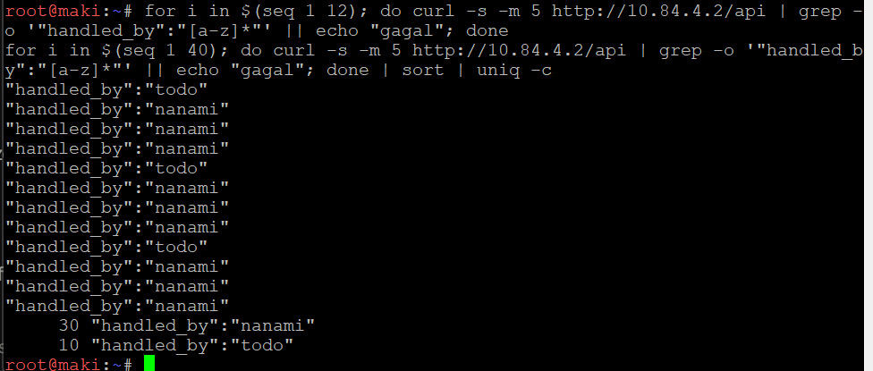
 
> 📸 maki: loop 12 request menghasilkan pola berulang `nanami, nanami, nanami, todo` (9 nanami dan 3 todo), dan loop 40 request menghasilkan `30 nanami` dan `10 todo` tanpa satu pun `gagal`.
 
> Catatan: pada percobaan awal rasio tidak persis 3:1 (10 nanami : 2 todo) dan sebagian request lambat sekitar 3 detik. Penyebabnya dua hal. Pertama, upstream tanpa `zone` menghitung bobot per worker process, sehingga ditambahkan `zone api_cluster 64k;`. Kedua, MAC address geto ternyata sama dengan yaga (terlihat dari alamat IPv6 link-local yang identik dan tabel `ip neigh`), sehingga paket TCP sering hilang. MAC geto kemudian diganti menjadi `02:42:0a:54:04:02` dan dipasang di `/root/.bashrc` agar bertahan setelah restart.
 
---
 
## Soal 16
Gojo berdiri di perbatasan DMZ sebagai gerbang publik tunggal bagi seluruh client dari luar maupun dalam. Konfigurasikan **Nginx** pada **gojo** untuk melayani domain `jujutsu.<xxxx>.com` dan `www.jujutsu.<xxxx>.com` menggunakan metode **Path-Based Routing.** Atur agar request root (/) diteruskan secara Round Robin ke worker frontend (maki dan panda), sedangkan request ke path /api diteruskan langsung ke geto. Uji dari client Divisi A atau B bahwa akses ke web utama dibalas oleh Maki/Panda, sedangkan akses ke /api diteruskan dan dijawab oleh Nanami/Todo.
 
### Ringkasan
*Gojo menjalankan Nginx untuk `jujutsu.K41.com` dan `www.jujutsu.K41.com`. Path `/` diteruskan Round Robin ke maki dan panda, path `/api` diteruskan ke geto. Diuji dari client Divisi A dan B.*
 
### 1. Langkah Pengerjaan
 
1. Memasang `nginx` dan `curl` pada gojo.
2. Membuat `upstream web_cluster` berisi maki (`10.84.4.21`) dan panda (`10.84.4.22`) dengan Round Robin bawaan dan `zone web_cluster 64k;`.
3. Membuat server block dengan `server_name jujutsu.K41.com www.jujutsu.K41.com`, `location /api` ke geto (`10.84.4.2`), dan `location /` ke `web_cluster`.
4. Memvalidasi dengan `nginx -t`, lalu `service nginx restart`.
5. Menguji dari gojo dan dari client Divisi A (itadori) dan Divisi B (ino atau kusakabe) melalui nama domain.
### 2. Command
 
**gojo** — `/etc/nginx/conf.d/gojo.conf`
```nginx
upstream web_cluster {
    zone web_cluster 64k;
    server 10.84.4.21;    # maki
    server 10.84.4.22;    # panda
}
 
server {
    listen 80 default_server;
    server_name jujutsu.K41.com www.jujutsu.K41.com;
 
    proxy_set_header Host $host;
 
    location /api {
        proxy_pass http://10.84.4.2;
    }
 
    location / {
        proxy_pass http://web_cluster;
    }
}
```
 
```sh
nginx -t && service nginx restart
```
 
**Verifikasi** (dari itadori dan satu client Divisi B)
```sh
curl -s http://jujutsu.K41.com/
curl -s http://www.jujutsu.K41.com/
for i in 1 2 3 4; do curl -s http://jujutsu.K41.com/ | grep -o '<b>[a-z]*</b>'; done
for i in 1 2 3 4 5 6 7 8; do curl -s http://jujutsu.K41.com/api | grep -o '"handled_by":"[a-z]*"'; done
 
curl -s -o /dev/null -w "langsung ke maki   : %{http_code}\n" http://10.84.4.21/
curl -s -o /dev/null -w "lewat gojo (web)   : %{http_code}\n" http://jujutsu.K41.com/
curl -s -o /dev/null -w "langsung ke nanami : %{http_code}\n" http://10.84.4.31/api
curl -s -o /dev/null -w "lewat gojo (api)   : %{http_code}\n" http://jujutsu.K41.com/api
```
 
Hasil yang diharapkan: halaman utama dijawab `maki` dan `panda` bergantian, `/api` dijawab `nanami` dan `todo` dengan pola 3:1, dan keempat baris `http_code` bernilai `403`, `200`, `403`, `200`.
 
> 📸 *(Screenshot soal ini belum ada di repo. Ambil dari itadori dan satu client Divisi B: loop halaman utama yang bergantian `maki` dan `panda`, loop `/api` yang dijawab `nanami` dan `todo`, serta keempat baris `http_code`. Output terakhir ini sekaligus melengkapi bukti "melalui reverse proxy tetap berhasil" pada Soal 14.)*
 
---
 
## Soal 17
Komando pusat perlu mengetahui IP asli klien yang mengirimkan request tanpa tertukar dengan IP proxy perantara. Konfigurasikan **gojo** dan **geto** agar meneruskan informasi alamat klien melalui header **X-Real-IP** dan **X-Forwarded-For**. Pastikan **geto** hanya mempercayai informasi alamat klien yang diterima dari proxy terpercaya, dan skrip API menyimpan alamat klien yang telah diverifikasi ke kolom **client_ip** pada tabel **request_logs** di database **yaga.** Uji dengan mengirimkan request dari klien Network 2 dan Network 3 ke endpoint **/api**, kemudian periksa database untuk memastikan alamat yang tercatat sesuai dengan IP klien asal, bukan IP **gojo** atau **geto.**
 
### Ringkasan
*Gojo menimpa header `X-Real-IP` dan `X-Forwarded-For` dengan `$remote_addr`. Geto hanya mempercayai header itu jika koneksi berasal dari gojo (`10.84.1.4`). API worker hanya mempercayai `X-Real-IP` dari geto (`10.84.4.2`) dan menyimpannya ke `client_ip`. Diuji dari client Network 2 dan 3, lalu dicek di database.*
 
### 1. Langkah Pengerjaan
 
1. Pada gojo: menambahkan `proxy_set_header X-Real-IP $remote_addr;` dan `proxy_set_header X-Forwarded-For $remote_addr;`. Header dari klien ditimpa karena gojo adalah tepi publik.
2. Pada geto: menambahkan `geo $trusted_proxy` (hanya `10.84.1.4/32` yang bernilai `1`) dan dua `map` (`$verified_ip` dan `$verified_xff`). Dari sumber terpercaya header gojo dipakai, dari sumber lain header diabaikan dan yang dipakai `$remote_addr`.
3. Pada nanami, todo, dan kirara: mengubah `index.php` agar `X-Real-IP` hanya dipercaya jika `REMOTE_ADDR` adalah `10.84.4.2` dan nilainya valid (`FILTER_VALIDATE_IP`). JSON respons ditambah kolom `xff` dan `via`.
4. Memvalidasi dengan `nginx -t`, restart `nginx`, lalu menguji dari itadori (Network 2) dan ino (Network 3).
5. Menguji pemalsuan header: lewat gojo dan langsung ke geto dari maki.
### 2. Command
 
**gojo** — tambahan di server block
```nginx
proxy_set_header Host $host;
proxy_set_header X-Real-IP $remote_addr;
proxy_set_header X-Forwarded-For $remote_addr;
```
 
**geto** — tambahan di `/etc/nginx/conf.d/api_cluster.conf`
```nginx
geo $trusted_proxy {
    default      0;
    10.84.1.4/32 1;
}
 
map "$trusted_proxy:$http_x_real_ip" $verified_ip {
    default                 $remote_addr;
    "~^1:(?<rip>.+)$"       $rip;
}
 
map "$trusted_proxy:$http_x_forwarded_for" $verified_xff {
    default                 $remote_addr;
    "~^1:(?<fwd>.+)$"       "$fwd, $remote_addr";
}
```
```nginx
server {
    listen 80 default_server;
    server_name _;
 
    proxy_set_header Host $host;
    proxy_set_header X-Real-IP $verified_ip;
    proxy_set_header X-Forwarded-For $verified_xff;
 
    location /api {
        proxy_pass http://api_cluster;
    }
    location / { return 404; }
}
```
 
**nanami, todo, kirara** — potongan `/var/www/api/index.php`
```php
$client = $_SERVER['REMOTE_ADDR'];
// X-Real-IP hanya dipercaya jika koneksi datang dari geto
if ($client === '10.84.4.2' && filter_var($_SERVER['HTTP_X_REAL_IP'] ?? '', FILTER_VALIDATE_IP)) {
    $client = $_SERVER['HTTP_X_REAL_IP'];
}
```
 
**Verifikasi**
```sh
# itadori (Network 2) dan ino (Network 3)
curl -s http://jujutsu.K41.com/api
 
# pemalsuan header lewat gojo (itadori)
curl -s -H "X-Real-IP: 1.2.3.4" -H "X-Forwarded-For: 1.2.3.4" http://jujutsu.K41.com/api
 
# pemalsuan header langsung ke geto (maki)
curl -s -H "X-Real-IP: 9.9.9.9" -H "X-Forwarded-For: 9.9.9.9" http://10.84.4.2/api
 
# yaga
mariadb -e "SELECT id, client_ip, request_path, handled_by FROM db_shibuya_K41.request_logs ORDER BY id DESC LIMIT 8;"
```
 
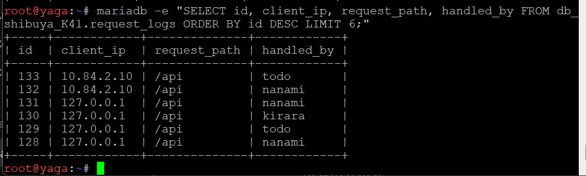
 
> 📸 yaga: `client_ip` berisi `10.84.2.10` (itadori) dan `10.84.3.10` (ino), bukan `10.84.1.4` (gojo) atau `10.84.4.2` (geto).
 
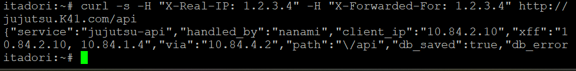
 
> 📸 itadori mengirim header palsu `1.2.3.4`, namun JSON menampilkan `client_ip` `10.84.2.10`, `xff` `10.84.2.10, 10.84.1.4`, dan `via` `10.84.4.2`. Header palsu ditimpa oleh gojo.
 
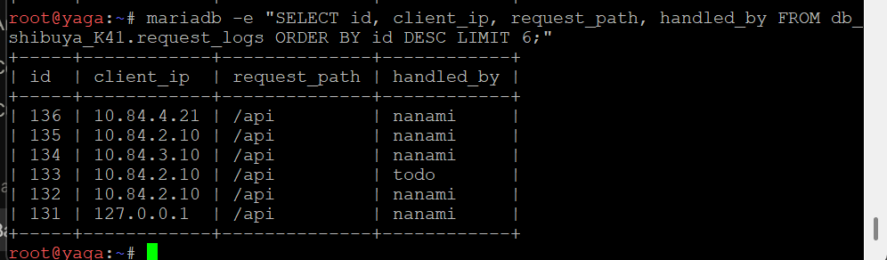
 
> 📸 yaga: setelah request dari itadori, ino, dan maki (dengan header palsu `9.9.9.9`), tercatat `10.84.2.10`, `10.84.3.10`, dan `10.84.4.21`. Geto tidak mempercayai header dari sumber selain gojo.
 
> Catatan: dua screenshot lain di folder `soal_17` (`Soal-17-1` dan `Soal-17-4`) adalah perbaikan karakter `[ ]( )` yang berubah menjadi tautan Markdown saat konfigurasi gojo ditempel ke terminal, dan tidak termasuk bukti inti soal ini.
 
---
 
## Soal 18
**nanami** dan **todo** merupakan worker API utama, sedangkan **kirara** disiapkan sebagai worker cadangan. Konfigurasikan upstream `api_cluster` pada **geto** agar **kirara** menjadi server backup, serta terapkan passive health check dengan parameter `max_fails=2` dan `fail_timeout=5s` pada worker API utama. Pastikan **kirara** menjalankan layanan API yang kompatibel dengan endpoint utama. Simulasikan gangguan dengan menghentikan layanan Nginx atau layanan API pada **nanami** dan **todo**. Buktikan dari klien bahwa request ke **/api** dialihkan ke **kirara** dan menghasilkan respons API yang valid tanpa error **502 Bad Gateway.**
 
### Ringkasan
*Pada upstream `api_cluster` di geto, nanami dan todo diberi `max_fails=2 fail_timeout=5s`, dan kirara ditambahkan sebagai `backup`. Saat Nginx nanami dan todo dimatikan, request ke `/api` tetap dijawab kirara dengan HTTP 200 dan JSON valid, tanpa 502.*
 
### 1. Langkah Pengerjaan
 
1. Memastikan kirara menjalankan layanan API yang sama dengan nanami dan todo (script `14_kirara.sh`, endpoint `/api` yang sama).
2. Mengubah `upstream api_cluster` di geto: `max_fails=2 fail_timeout=5s` pada nanami dan todo, dan `backup` pada kirara.
3. Menambahkan `proxy_connect_timeout 2s;` dan `proxy_next_upstream error timeout http_502 http_503 http_504;` agar request yang gagal dicoba ulang ke server berikutnya dalam satu permintaan yang sama.
4. Memvalidasi dengan `nginx -t`, lalu `service nginx restart`.
5. Menghentikan Nginx di nanami dan todo, mengirim request dari itadori dan ino, lalu memeriksa kode HTTP, JSON, `error.log` geto, dan database.
6. Menyalakan kembali nanami dan todo, menunggu lebih dari `fail_timeout`, dan memastikan distribusi kembali ke nanami dan todo.
### 2. Command
 
**geto** — `/etc/nginx/conf.d/api_cluster.conf`
```nginx
upstream api_cluster {
    zone api_cluster 64k;
    server 10.84.4.31 weight=3 max_fails=2 fail_timeout=5s;    # nanami
    server 10.84.4.32 weight=1 max_fails=2 fail_timeout=5s;    # todo
    server 10.84.4.33 backup;                                  # kirara
}
```
```nginx
location /api {
    proxy_connect_timeout 2s;
    proxy_next_upstream error timeout http_502 http_503 http_504;
    proxy_pass http://api_cluster;
}
```
 
**Simulasi gangguan dan verifikasi**
```sh
# nanami dan todo
service nginx stop
 
# itadori
for i in 1 2 3 4 5 6; do curl -s -o /dev/null -w "HTTP %{http_code}\n" http://jujutsu.K41.com/api; done
curl -s http://jujutsu.K41.com/api
 
# geto
grep -E "10.84.4.3[12]" /var/log/nginx/error.log | tail -n 10
 
# yaga
mariadb -e "SELECT id, client_ip, request_path, handled_by FROM db_shibuya_K41.request_logs WHERE handled_by='kirara' ORDER BY id DESC LIMIT 6;"
 
# pemulihan
service nginx start      # nanami dan todo
```
 
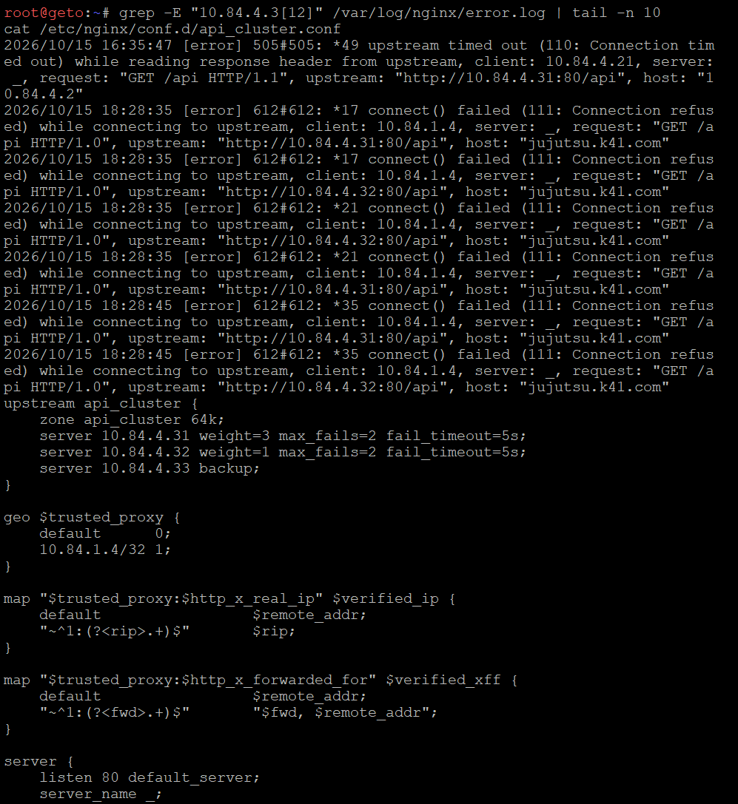
 
> 📸 geto: `error.log` menampilkan `connect() failed (111: Connection refused)` ke `10.84.4.31`, dan isi `upstream api_cluster` dengan `max_fails=2`, `fail_timeout=5s`, serta `backup` pada kirara.
 
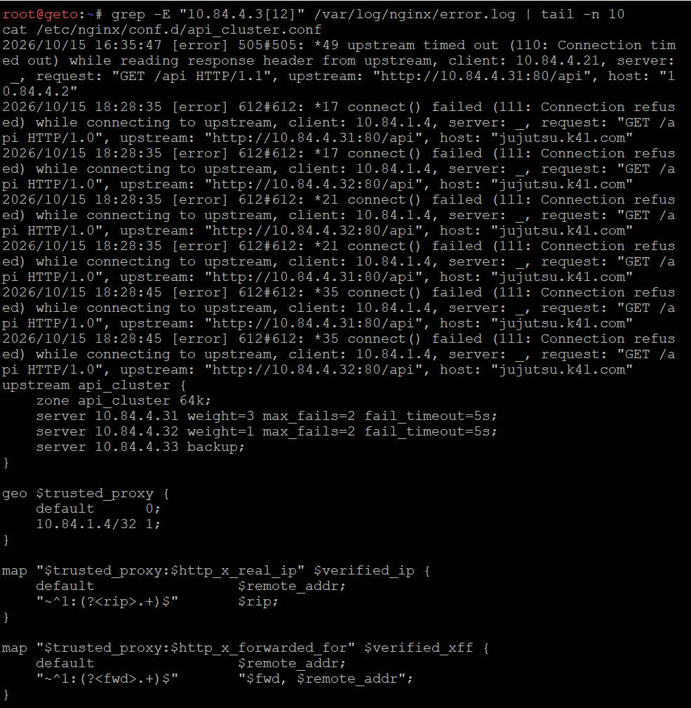
 
> 📸 geto: hal yang sama untuk `10.84.4.32` (todo).
 
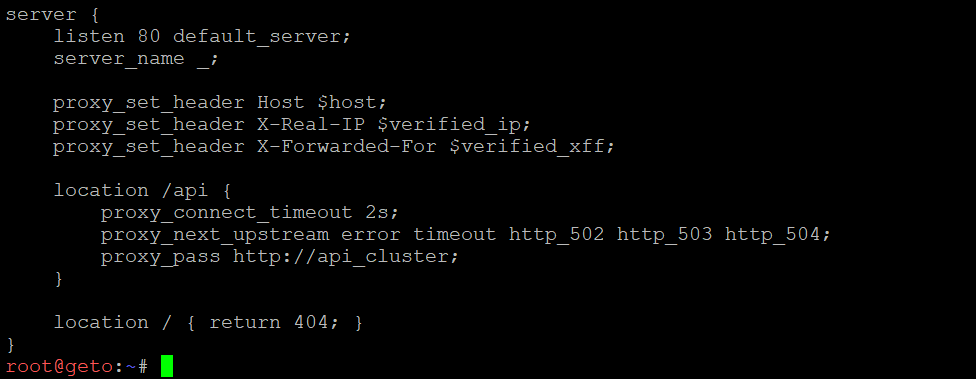
 
> 📸 geto: server block `location /api` dengan `proxy_connect_timeout 2s` dan `proxy_next_upstream error timeout http_502 http_503 http_504`.
 
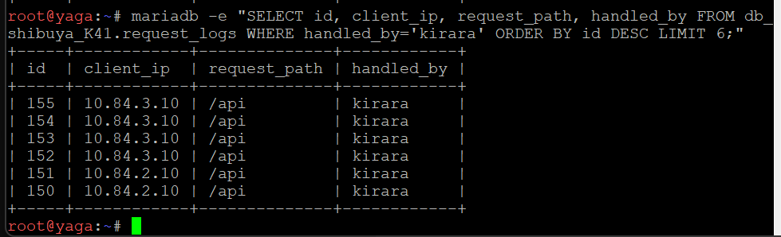
 
> 📸 yaga: seluruh request selama gangguan ditangani `kirara`, dengan `client_ip` `10.84.2.10` (itadori) dan `10.84.3.10` (ino).
 
> 📸 *(Tambahkan screenshot dari itadori: enam baris `HTTP 200` dan JSON dengan `"handled_by":"kirara"`. Ini bukti utama "tanpa 502" yang belum ada di repo. `Soal-18-3-2` isinya sama dengan `Soal-18-1-2` sehingga tidak perlu ditampilkan dua kali.)*
 
---
 
## Soal 19
**gojo** bertugas mengoptimalkan layanan web sekaligus membatasi request berlebihan. Konfigurasikan Nginx Proxy Caching untuk halaman web frontend dengan masa berlaku cache 10 menit dan tambahkan header **X-Cache-Status**. Terapkan rate limiting pada path **/api** dengan batas 10 request per detik per IP klien. Buktikan bahwa request ke halaman web yang memenuhi syarat cache menghasilkan status **MISS** pada akses awal dan **HIT** pada akses berikutnya. Uji rate limiting secara terpisah dengan mengirimkan request beruntun ke **/api**, kemudian catat status respons yang dihasilkan ketika batas terlampaui.
 
### Ringkasan
*Gojo memakai `proxy_cache` 10 menit untuk path `/` dengan header `X-Cache-Status`, dan `limit_req` 10 request per detik per IP pada `/api`. Cache dibuktikan dengan `MISS` lalu `HIT`, dan rate limit dengan request beruntun yang melewati batas dan dijawab `503`.*
 
### 1. Langkah Pengerjaan
 
1. Membuat direktori `/var/cache/nginx` dan mendefinisikan `proxy_cache_path` (`keys_zone=web_cache:10m`).
2. Mengaktifkan `proxy_cache web_cache;` dan `proxy_cache_valid 200 10m;` pada `location /`, lalu menambahkan `add_header X-Cache-Status $upstream_cache_status;`.
3. Mendefinisikan `limit_req_zone $binary_remote_addr zone=api_limit:10m rate=10r/s;` dan menerapkan `limit_req zone=api_limit nodelay;` pada `location /api` dengan `limit_req_status 503`.
4. Menambahkan `log_format gojo` yang mencatat `status`, `upstream_status`, `limit_req_status`, dan `upstream_cache_status` ke `gojo_access.log` untuk analisis di Soal 20.
5. Memvalidasi dengan `nginx -t`, lalu `service nginx restart`.
6. Menguji cache dengan `curl -I` dua kali, dan rate limiting dengan 20 request paralel ke `/api`.
### 2. Command
 
**gojo** — `/etc/nginx/conf.d/gojo.conf`
```nginx
proxy_cache_path /var/cache/nginx levels=1:2 keys_zone=web_cache:10m max_size=100m inactive=60m use_temp_path=off;
limit_req_zone $binary_remote_addr zone=api_limit:10m rate=10r/s;
 
log_format gojo 'status=$status upstream=$upstream_status limit=$limit_req_status cache=$upstream_cache_status ip=$remote_addr req="$request" rt=$request_time';
 
server {
    listen 80 default_server;
    server_name jujutsu.K41.com www.jujutsu.K41.com;
 
    access_log /var/log/nginx/access.log;
    access_log /var/log/nginx/gojo_access.log gojo;
 
    proxy_set_header Host $host;
    proxy_set_header X-Real-IP $remote_addr;
    proxy_set_header X-Forwarded-For $remote_addr;
 
    location /api {
        limit_req zone=api_limit nodelay;
        limit_req_status 503;
        proxy_pass http://10.84.4.2;
    }
 
    location / {
        proxy_cache web_cache;
        proxy_cache_valid 200 10m;
        add_header X-Cache-Status $upstream_cache_status;
        proxy_pass http://web_cluster;
    }
}
```
 
**Verifikasi** (dari itadori)
```sh
# cache: akses pertama MISS, akses berikutnya HIT
curl -I http://jujutsu.K41.com/
curl -I http://jujutsu.K41.com/
 
# rate limiting: 20 request beruntun
for i in $(seq 1 20); do curl -s -o /dev/null -w "%{http_code}\n" http://jujutsu.K41.com/api & done; wait
```
 
> 📸 *(Screenshot `curl -I` yang menampilkan `X-Cache-Status: MISS` pada akses pertama dan `X-Cache-Status: HIT` pada akses berikutnya belum ada di repo. Cache disimpan di disk, jadi untuk memperlihatkan `MISS` kosongkan dulu dengan `rm -rf /var/cache/nginx/*` lalu `service nginx restart` di gojo.)*
 
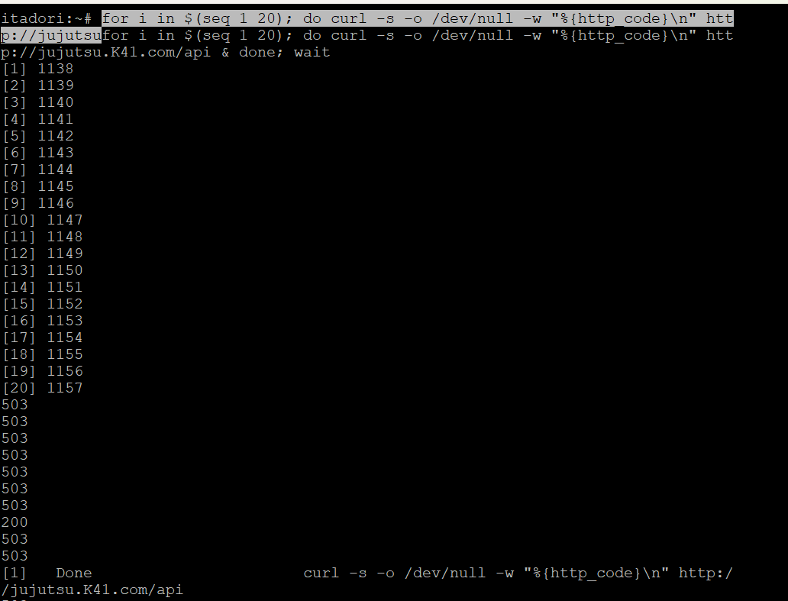
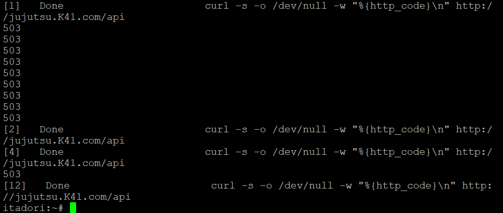
 
> 📸 itadori: 20 request beruntun ke `/api` hampir seluruhnya menghasilkan `503` dan hanya satu `200`. Status `503` adalah respons ketika batas 10 request per detik terlampaui.
 
> Catatan: selama cache aktif (10 menit), halaman `/` disajikan dari cache sehingga pergantian maki dan panda dari Soal 16 tidak terlihat. Untuk memperlihatkannya lagi, kosongkan cache terlebih dahulu.
 
---
 
## Soal 20
Sebelum Curtain di Shibuya resmi dibuka, Kusakabe memimpin audit untuk menguji kapasitas layanan. Dari terminal **kusakabe**, jalankan benchmark menggunakan Apache Benchmark dengan parameter `-n 600 -c 30` menuju `http://jujutsu.<xxxx>.com/`. Catat Requests per Second (RPS), latensi, dan jumlah request yang gagal. Lakukan pengujian tambahan pada endpoint **/api** untuk mengamati efek rate limiting. Bandingkan hasil pengujian baseline dengan hasil ketika rate limiting aktif, serta gunakan access log **gojo** untuk membedakan kegagalan aplikasi, koneksi, dan request yang ditolak oleh kebijakan rate limit.
 
### Ringkasan
*Dari kusakabe dijalankan `ab -n 600 -c 30` ke `/` dan `/api`. Halaman `/` (tanpa rate limit) menjadi baseline, sedangkan `/api` memperlihatkan efek rate limiting. Access log gojo dipakai untuk membedakan request sukses, ditolak rate limit, dan gagal di backend.*
 
### 1. Langkah Pengerjaan
 
1. Pada kusakabe: memasang `apache2-utils` (`apk add apache2-utils`) agar `ab` tersedia.
2. Menjalankan `ab -n 600 -c 30` ke `http://jujutsu.K41.com/` dan mencatat RPS, `Time per request`, dan `Failed requests`.
3. Menjalankan `ab -n 600 -c 30` ke `http://jujutsu.K41.com/api` dengan rate limiting aktif.
4. Menonaktifkan sementara `limit_req` di gojo, mengulang `ab` ke `/api` sebagai baseline `/api`, lalu menyalakan kembali rate limiting.
5. Memeriksa `gojo_access.log` untuk menghitung kombinasi `status`, `upstream`, dan `limit`.
### 2. Command
 
**kusakabe**
```sh
apk update && apk add apache2-utils
ab -n 600 -c 30 http://jujutsu.K41.com/
ab -n 600 -c 30 http://jujutsu.K41.com/api
```
 
**gojo** — baseline `/api` tanpa rate limiting (sementara)
```sh
sed -i 's/^\(\s*\)limit_req zone=api_limit nodelay;/\1#limit_req zone=api_limit nodelay;/' /etc/nginx/conf.d/gojo.conf
nginx -t && service nginx reload
# jalankan ab ke /api dari kusakabe, lalu nyalakan lagi:
bash /root/19_gojo.sh
```
 
**gojo** — analisis log
```sh
grep 'req="GET /api' /var/log/nginx/gojo_access.log | awk '{print $1,$2,$3}' | sort | uniq -c
grep -c "limiting requests" /var/log/nginx/error.log
```
 
Cara membaca log:
 
| Pola di `gojo_access.log` | Artinya |
|---|---|
| `status=200 upstream=200` | Request sukses sampai backend. |
| `status=503 upstream=- limit=REJECTED` | Ditolak oleh rate limit, tidak pernah sampai backend. |
| `status=502` atau `504` dengan `upstream=502` atau `504` | Kegagalan aplikasi atau koneksi ke backend. |
| `Connect` atau `Exceptions` pada keluaran `ab` | Kegagalan koneksi di sisi klien. |
 
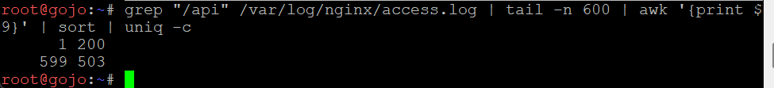
 
> 📸 gojo: dari 600 request ke `/api` yang dicatat, `1` berstatus `200` dan `599` berstatus `503`. Ini efek rate limit: request melebihi 10 per detik ditolak.
 
> 📸 *(Tambahkan screenshot keluaran `ab` dari kusakabe untuk `/` dan `/api` (rata-rata sekitar 6626 RPS dengan 0 request gagal untuk `/`, dan sekitar 6517 RPS dengan 599 respons non-2xx untuk `/api`), baseline `/api` tanpa rate limiting, serta hasil analisis `gojo_access.log` dengan format log baru.)*
 
### Perbandingan
 
| Skenario | Requests per second | Time per request (rata-rata) | Failed requests |
|---|---|---|---|
| `/` (baseline, cache aktif) | 6626 | 4,5 ms | 0 |
| `/api` dengan rate limit aktif | 6517 | — | 599 respons `503` |
| `/api` tanpa rate limit (baseline `/api`) | *(isi dari hasil `ab` setelah rate limit dimatikan)* | — | — |
 
RPS tinggi pada `/api` dengan rate limit bukan tanda performa backend yang baik. Itu terjadi karena sebagian besar request ditolak Nginx di gojo dengan cepat dan tidak pernah sampai ke backend.
